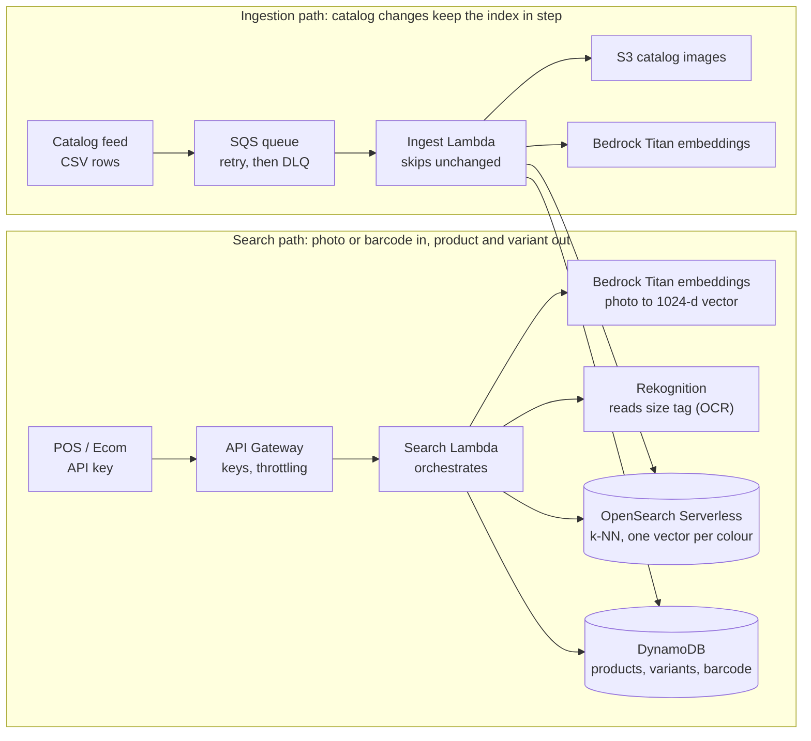

# Visual Search API: Design Doc

Image (and/or barcode) in, matching catalog product and exact variant out, through one API that POS and e-commerce systems share.
AWS-native by default; the vector store, catalog database and embedding model are swappable.

## Overview

**Goals**

- Image in, product details out. AWS-native by default, with the vector store, catalog database and embedding model swappable (Solr, MySQL and others).
- Resolve variants: a photo of an XL shirt returns the XL SKU.
- Scale efficiently: index size grows with styles × colours, not with SKU count.
- Serve both channels (POS, ecom) with per-client keys and throttling.

**Non-goals**

- Inferring size from pixels alone; a photo cannot reliably show it.
- Text search over the catalog.
- Owning inventory: stock is read from the catalog or an external system, not managed here. Inventory check is a read-only use case.

## Architecture

A search embeds the photo, matches it in OpenSearch, and resolves the variant from DynamoDB; a separate queue-fed Lambda keeps those same stores current.

The diagram shows the default AWS backends; OpenSearch and DynamoDB can each be replaced through the adapters described under Extensibility. On the search path, the embedding call and the size OCR run in parallel. Both Lambdas use their own IAM role, and the index is reachable only with signed requests.

## Extensibility: swappable backends

The core engine depends only on six small interfaces (ports); each backend is an adapter chosen by an environment variable, so Solr, MySQL or another model can replace the AWS defaults without touching core code.

| Port | What it does | Built in (default first) | Setting |
| --- | --- | --- | --- |
| Embedder | Photo to unit-length vector | Bedrock Titan; `local` (test only) | `EMBEDDER` |
| VectorStore | Add, delete, k-NN with exact-match filters | OpenSearch (Serverless or domain), Apache Solr 9.x; `local` (test only) | `VECTOR_STORE` |
| CatalogStore | Products, variants, barcode lookup, index registry | DynamoDB, MySQL / Aurora MySQL; `local` (test only) | `CATALOG_STORE` |
| InventoryProvider | Stock per SKU and store | Stock stored on variant rows | `INVENTORY` |
| TextReader | Reads a size tag from the photo | Rekognition, or none | `OCR` |
| ImageStore | Fetches query and catalog images | S3; `local` (test only) | `IMAGE_STORE` |

Three rules keep adapters interchangeable:

- A vector store returns scores as cosine similarity from 0 to 1, so the score thresholds mean the same on any engine. Each adapter converts its engine's native score.
- Vectors are unit length, so L2 and cosine rank the same way. The dimension comes from the embedder.
- A vector store does not need upserts or custom ids; the catalog's registry tracks which document holds each product and colour.

To add a backend, implement the port and set the variable to its dotted path (for example `VECTOR_STORE=mypkg.mod:MyStore`) or register it in code. Handlers are thin wrappers around one shared function, so a new use case reuses the same matching engine.

AWS has no managed Solr, so Solr runs on EC2, ECS or EKS and the Lambdas join its VPC. MySQL needs the same VPC access plus RDS Proxy to absorb Lambda connections. Switching backends means re-running ingestion into the new one; there is no live migration.

## Data model

The vector index holds one document per product and colour; everything specific to a SKU lives in the catalog database (DynamoDB by default; MySQL uses the same fields in three tables plus a JSON column for extra attributes).

| Store | Key | Holds |
| --- | --- | --- |
| Products (DynamoDB) | `product_id` | name, brand, category, description, price, url, active flag |
| Variants (DynamoDB) | `product_id` + `sku`; GSI `barcode-index` on `barcode` | colour, size, price, barcode, stock (a number, or a map per store) |
| IndexRegistry (DynamoDB) | `product_id` + colour | image hash, metadata hash, OpenSearch document id |
| products index (OpenSearch Serverless) | generated document id | 1024-d embedding, `product_id`, colour, category, brand, `image_key` |

Indexing per colour rather than per SKU matters because size variants share a photo: index size scales with styles × colours, not with SKU count.

Vectors are normalised to unit length and stored with HNSW (Faiss engine, L2 distance, m=16, ef_construction=128). Cosine similarity is recovered from the returned score as 1 − d²/2, which keeps scores comparable across queries.

## API contract

The main endpoint is `POST /v1/search`, authenticated with an `x-api-key` header; send an image, a barcode, or both.

| Request field | Meaning |
| --- | --- |
| `image_base64` or `image_s3_key` | The photo. Downscale to about 1024px JPEG; hard limit 5 MB. S3 keys must sit under `queries/`. |
| `barcode` | Resolves the exact SKU directly. If an image is also sent, it cross-checks the barcode. |
| `size` | Size hint such as XL. Takes priority over OCR. |
| `store_id` | Enables per-store stock and stock-based size narrowing. |
| `category`, `brand` | Optional exact-match filters on the image search. |
| `top_k` | Matches to return, default 5, maximum 20. |
| `detect_size` | Set false to skip OCR of a size tag. |

Each match returns the product, a similarity score, a confidence label (high, medium, low), how it was matched (image or barcode), a `variant_resolution` object, and the variants of that colour with stock where known. When a barcode and an image are both sent, `image_agrees` tells the POS whether the photo supports the scanned item.

| `variant_resolution.status` | Meaning |
| --- | --- |
| `exact` | Style, colour and size are resolved; `matched_variant` is the SKU. |
| `inferred_by_stock` | Size was not given, but only one size is in stock at that store. Treated as a suggestion. |
| `size_required` | Style and colour are known; size is ambiguous. `available_sizes` and `in_stock_sizes` let the caller ask. |
| `size_not_available` | That colour is not sold in the requested size. |
| `no_variants` | The product has no variant rows. |

Errors: 400 for invalid input, 404 when only a barcode was sent and it is unknown, 403 for a bad key, 429 when throttled. No match above the minimum score returns 200 with an empty list.

## Use case: store inventory check

`POST /v1/inventory/check` answers "do we have this item, and where?" from a photo or barcode, using the same matching engine as search.

It takes the same fields as search, with `store_id` required. For each match it returns the resolved SKU's quantity at that store, the quantity of every size, and up to five other stores holding the SKU (`max_other_stores`). If the photo shows a size that is out of stock at the store, the response says so and lists where it is available.

Stock comes from the stock field on each variant (a number, or a quantity per store). To use a live order or warehouse system instead, implement the InventoryProvider port with a lookup by SKU and store; no other code changes.

Further use cases, such as similar-item suggestions, returns lookup or price check, follow the same pattern: a thin handler over the shared engine and a new route.

## Variant resolution

A photo identifies style and colour but not size, so the API takes size from the first reliable source below and asks the caller when none exists.

1. **Barcode.** A scanned barcode maps to exactly one SKU through the barcode-index. If an image is also sent, `image_agrees` shows whether the photo supports the scanned item.
2. **Request hint.** The `size` field, filled from a tag, a size picker, or the shopper's choice.
3. **OCR.** Rekognition reads a size tag visible in the photo. It is used only when exactly one size token (XS to XXXL) is read at 85% confidence or higher.
4. **Stock.** With a `store_id` and no size, if only one size of that colour is in stock, it is returned as `inferred_by_stock`. This is a suggestion, labelled as such.
5. **Ask.** Otherwise the status is `size_required`, with `available_sizes` and `in_stock_sizes` so the app can prompt.

Colour comes from the best-matching indexed image, because each colour has its own photo. If the requested size is out of stock the SKU is still returned with `in_stock: false`, and an in-stock SKU is preferred when several match.

Numeric sizes (shoes, waist) work through the barcode or the hint only; OCR reads letter sizes.

## Ingestion pipeline

Catalog changes arrive as one SQS message per variant, and an ingest Lambda keeps DynamoDB and the vector index in step.

1. **Feed.** A catalog CSV is enqueued with `enqueue_catalog.py`; images sit in S3 under `catalog/`.
2. **Upsert.** The Lambda writes the product and variant rows, including barcode and stock.
3. **Skip unchanged.** It hashes the image. If the hash and the product's category and brand are unchanged for that colour, it stops, so other sizes of a colour and stock-only updates cost no embedding.
4. **Embed and index.** Otherwise it embeds the image with Bedrock, adds a vector document, records its id in IndexRegistry, then deletes the stale document. Vector collections do not support custom ids or upserts, which is why the registry exists.
5. **Fail safely.** Failed messages are retried individually, three failures go to a dead-letter queue, and concurrency is capped at 10 to stay under the Bedrock throughput quota.

New documents become searchable within seconds, not instantly. To delist a product, set its active flag to false; search drops inactive products after the lookup, and the stale vector is removed on the next re-index.

## Testing strategy

Testing runs in four levels, from free and instant to the only one that measures real accuracy.

| Level | What it checks | Cost and setup |
| --- | --- | --- |
| Unit tests (`tests/test_logic.py`) | Variant resolution, stock logic, handlers, adapter selection, using in-memory fakes | Seconds; no setup; runs in CI |
| Local end-to-end (`scripts/local_server.py` + `scripts/e2e_test.py`) | Ingest, search, size hint, barcode, stock inference, inventory check, through the real handlers on in-memory adapters | Free; needs Pillow; runs in CI |
| Deployed end-to-end (`scripts/load_sample_catalog.sh` + `scripts/e2e_test.py`) | The same answer key against real Bedrock, OpenSearch and DynamoDB, plus latency and score statistics | AWS cost; run after deploy |
| Real catalog and photos | Top-1 and top-3 accuracy on real products; threshold tuning | Needs your catalog and phone photos |

A generator (`scripts/generate_sample_catalog.py`) produces a synthetic catalog feed, catalog images and a labelled query set with an answer key. The queries cover photo only, photo plus size, barcode, stock inference, inventory check, size-tag reading and non-clothing photos that should not match. Products that share a shape and pattern never share a colour, so each query has one right answer.

The pass bar is 85% for photo-based retrieval and 100% for barcode, stock inference and inventory. Size-tag and non-clothing checks are reported but do not fail a run. The synthetic catalog and the local pixel-based embedder prove the plumbing, not accuracy: only the last level does that, and its results should set the `MIN_SCORE` and `HIGH_SCORE` thresholds.

## Scale, performance and cost

The Bedrock embedding call dominates latency and cost per search; everything else is a managed, auto-scaling service. Latency and cost have not been measured yet, so the figures below are targets to verify in a load test.

| Lever | How it helps |
| --- | --- |
| One vector per product and colour | Keeps the index small and k-NN fast; index size does not grow with sizes. |
| Parallel embedding and OCR | The two calls run at the same time, so OCR adds little latency. |
| Batch lookups | One DynamoDB batch-get for products plus parallel variant queries for the top matches. |
| Hash-based skip on ingest | Re-syncing the whole catalog only embeds images that changed. |
| OCR switch (`ENABLE_OCR`) | Turn it off when size is always supplied; saves Rekognition cost and time. |
| Provisioned concurrency | Set `-c search_provisioned=N` to remove Lambda cold starts for POS use. |
| OpenSearch Serverless capacity limits | Set minimum and maximum OCUs to bound cost; the minimum is a standing cost even at low traffic. |

Bottlenecks to watch: the Bedrock throughput quota for the embedding model (ingest is capped at 10 concurrent Lambdas for this reason), the 6 MB Lambda payload limit (clients should downscale photos), and AOSS capacity during bulk loads.

Targets to test: search p95 under 1 second end to end, and a full-catalog re-index that finishes within a planned maintenance window. A provisioned OpenSearch domain becomes cheaper than Serverless only once traffic is steady and high; compare using real query volume.

## Security, observability and operations

Access is least-privilege and IAM-based end to end; the main gap to close before production is network isolation.

**Security**

- API Gateway requires an API key per client (pos, ecom) with its own usage plan and throttle; add AWS WAF in front for abuse protection.
- The search Lambda can only read the data stores and invoke the embedding model; only the ingest Lambda can write. Each has its own role and its own OpenSearch data-access rule.
- The S3 bucket blocks public access and enforces TLS; query uploads under `queries/` expire after one day.
- The OpenSearch collection uses a public endpoint with IAM (SigV4) authentication. For production, move it behind a VPC endpoint and put the Lambdas in the VPC.
- Customer photos can contain people. Do not store query images beyond the one-day window, and avoid logging image bytes.

**Observability**

- Alarm on: dead-letter queue depth, search Lambda errors and p95 duration, API Gateway 5xx and 429 rates, Bedrock throttles.
- Track match quality, not just uptime: share of searches returning no match, share of high-confidence matches, and for barcode scans how often `image_agrees` is false.
- X-Ray tracing is enabled on the API stage.

**Operations**

- Changing the embedding model or dimension means building a new index and re-embedding every image, then switching the alias or environment variable.
- Confirm the embedding model is active in the target region before deploying, and watch its lifecycle status.
- `scripts/teardown.sh` removes every resource the stack created, including those CDK keeps on destroy.

## Risks, alternatives and rollout

The biggest risk is match quality on real shopper and cashier photos, which differ from studio catalog images; the rollout is built to measure that early.

| Risk | Mitigation |
| --- | --- |
| Lower accuracy on real-world photos | Index several angles per colour; calibrate score thresholds on labelled query photos before launch. |
| Wrong size returned | Size comes only from barcode, hint, OCR or stock, never guessed from pixels; ambiguous cases return `size_required`. |
| General-purpose model underperforms on fashion | Benchmark a fashion-tuned model behind the same embedding function. |
| Embedding model retired or unavailable in region | Check lifecycle before deploy; the model ID, dimension and request body are isolated in one function. |
| Stock data stale | Stock-based inference is labelled `inferred_by_stock`; the POS should confirm. |

**Alternatives considered**

- *OpenSearch managed domain or Apache Solr instead of Serverless:* allows custom document ids and upserts and gives a fixed, predictable cost, but needs capacity planning, upgrades and manual scaling. Serverless is the start point; revisit with real traffic.
- *Per-SKU vectors:* rejected, since sizes share photos and the index would grow several times larger with no recall gain.
- *Inferring size from the image:* rejected as unreliable without a scale reference.

**Rollout**

1. Deploy to a dev account with about 50 products; test with real phone and in-store photos.
2. Calibrate `MIN_SCORE` and `HIGH_SCORE` on labelled queries; decide whether a different embedding model is needed.
3. Load the full catalog; run a load test for latency and cost.
4. Pilot in a few stores on the POS with barcode plus photo, watching `image_agrees` and no-match rates.
5. Open to ecom after the pilot thresholds hold.

**Open questions**

- Which categories dominate the catalog, and do they have numeric sizes?
- How fresh does per-store stock need to be, and where is it sourced?
- Do POS devices send photos, barcodes, or both?
